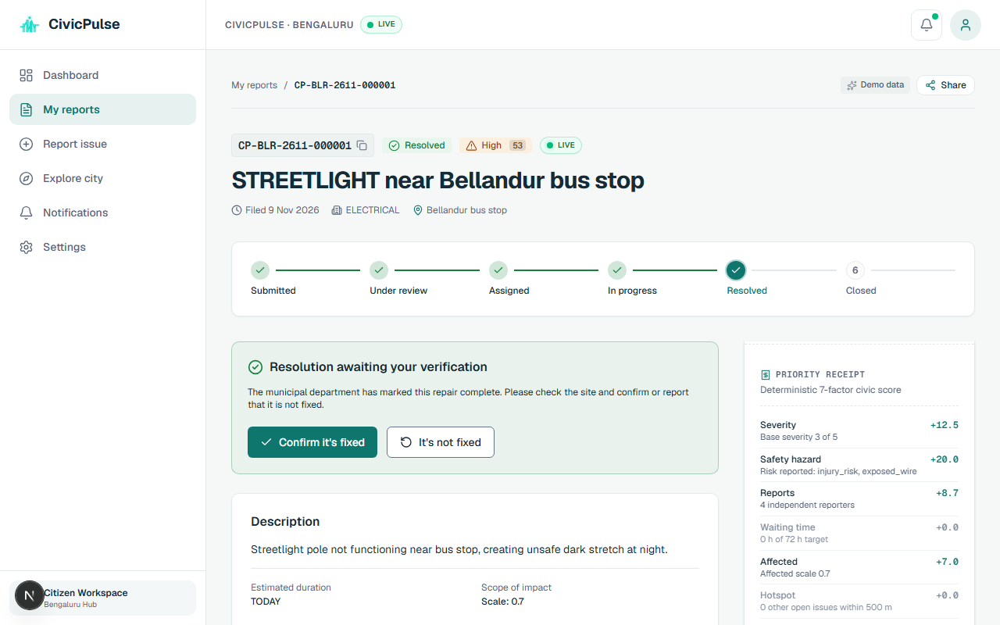
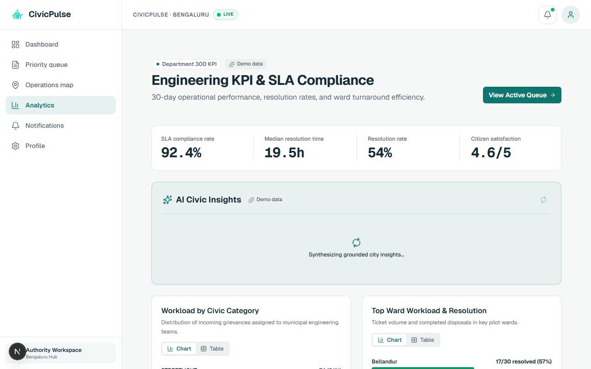
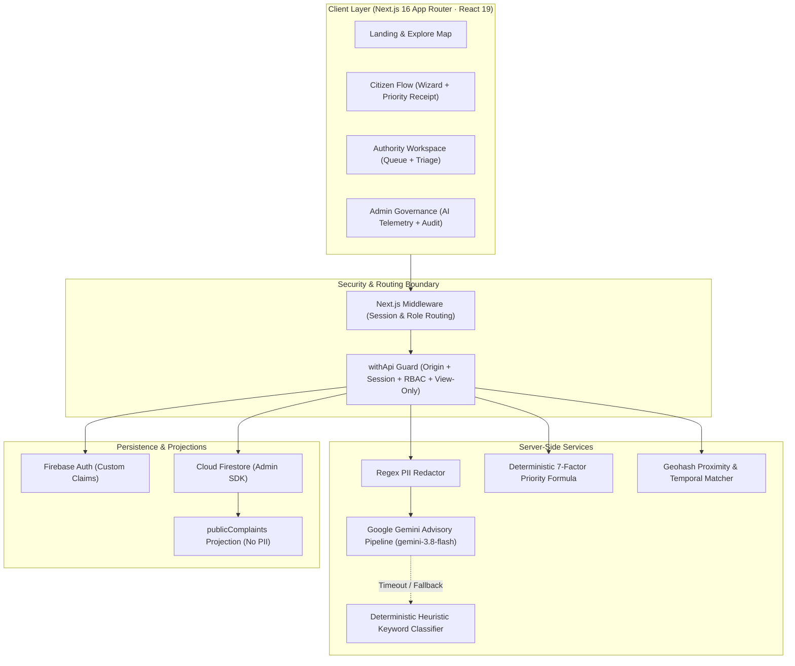

# CivicPulse AI

> **Turning Citizen Voices into Intelligent City Action with Explainable Priority Receipts & Spatial Duplicate Radar.**

CivicPulse AI transforms unstructured citizen grievances (potholes, garbage, water leaks, broken streetlights, stormwater drainage) into structured, localized, deduplicated, and **transparently prioritized** civic records in seconds — tracking each issue through to verified department resolution.

> **Independent Civic-Tech Prototype**: Built for modern municipal grievance triage. Not affiliated with, endorsed by, or operated on behalf of the BBMP or any government body. Demonstrations use synthetic data clearly badged with "Demo data".

---

## Live Application & Judge Mode

- **Live URL**: [https://<your-vercel-domain>](https://<your-vercel-domain>)
- **Repository**: [https://github.com/Cody-Abhi/Civic-Pulse](https://github.com/Cody-Abhi/Civic-Pulse)

### Try It as a Judge (1-Click Instant Access)

On the **Landing Page** (`/`) or **Sign In Page** (`/login`), click any role card in the **"Try it as a judge"** panel to enter immediately without typing credentials:

| Judge Role | 1-Click Access | Guided Tour Checklist | Guardrails |
| :--- | :--- | :--- | :--- |
| **Citizen Demo** | 1-click on `/` or `/login` | Report an issue &rarr; AI category suggestion &rarr; Duplicate radar &rarr; Priority Receipt | Auto-creates `isDemoSession` records |
| **Roads Authority** | 1-click on `/` or `/login` | Open top-priority complaint &rarr; Confirm duplicate &rarr; Resolve with photo evidence | Department-scoped queue |
| **Admin (View-Only)** | 1-click on `/` or `/login` | AI telemetry monitoring &rarr; Audit trail inspection &rarr; Grounded analytics insight | Mutations disabled via HTTP 403 & UI tooltips |

Each judge session mounts an interactive, collapsible, and dismissible **Guided Tour Checklist** that tracks progress across routes. Ephemeral demo documents are automatically purged nightly via Vercel Cron without touching baseline seed fixtures.

---

## Three Core Differentiators

### 1. Explainable Priority Receipt (0–100 Formula)
Priority is **never decided by an opaque LLM**. An auditable mathematical formula weighs 7 transparent dimensions: Severity (25%), Safety Hazard (20%), Citizen Reports (15%), Waiting Time / SLA (15%), Affected Scale (10%), Cluster Hotspot (10%), and Seasonal Vulnerability (5%). Every complaint renders an itemized receipt that recalculates dynamically as citizens add their voice.


### 2. Spatial Duplicate Radar ("Add My Voice")
Before duplicate tickets flood municipal departments, the local radar searches a 200m spatial-temporal window. Citizens click **"Add my voice"** to upvote existing issues rather than fragmenting queues. Authorities confirm duplicate links before merging.



### 3. Ward Pulse Map + Grounded AI Insights
Live geospatial visualization powered by MapLibre GL and vector basemaps. Administrators receive Gemini insight summaries that explicitly ground every recommendation in verifiable city metrics.



---

## System Architecture



### Architectural Guarantees
- **Zero Client Direct Writes to Firestore**: All mutations pass through authenticated route handlers guarded by Firebase Admin SDK.
- **Privacy by Design**: Indian phone numbers, emails, and street addresses are scrubbed before any LLM processing. Public feeds read from a dedicated `publicComplaints` projection with zero citizen identities.
- **Circuit Breakers & Graceful Degradation**: 8s strict timeout on Gemini inferences with deterministic regex fallback. Administrative safety switch allows immediate manual fallback enforcement.
- **View-Only Demo Isolation**: Demo judge accounts are strictly forbidden from mutating system state via server-side 403 enforcement.

---

## Getting Started Locally

### 1. Prerequisites
- **Node.js**: v20+
- **pnpm**: v9+
- **Java JRE**: 11+ (for Firebase Local Emulators)

### 2. Setup & Installation
```bash
git clone https://github.com/Cody-Abhi/Civic-Pulse.git
cd Civic-Pulse
pnpm install
cp .env.example .env.local
```

### 3. Run Development Stack
```bash
# Terminal 1: Start Firebase local Auth & Firestore emulators
pnpm exec firebase emulators:start --only auth,firestore

# Terminal 2: Seed synthetic complaints, departments & metrics
pnpm seed

# Terminal 3: Start Next.js development server
pnpm dev
```
Open [http://localhost:3000](http://localhost:3000) in your browser.

---

## Verification & Quality Gates

CivicPulse enforces strict, automated quality gates:

```bash
# Typecheck (0 TypeScript errors)
pnpm typecheck

# Linting & Token Guard (0 ESLint errors/warnings)
pnpm lint

# Unit Test Suite (144 unit tests across 12 test suites)
pnpm test

# Security Bundle Scanner (Asserts zero credentials leaked into client bundles)
pnpm check:bundle-secrets

# Environment Contract Check (Asserts zero drift between Zod schema & env)
pnpm check:env

# Full Next.js Production Build
pnpm build

# Automated Responsive Browser Verification (360px & 1280px screenshots)
node scripts/verify-block-d-live.mjs
```

---

## Deployment to Vercel

<!-- BEGIN:vercel-env -->
| Environment Variable | Description | Exposure |
| :--- | :--- | :--- |
| `APP_URL` | Production canonical URL (e.g. https://<your-vercel-domain>) | Server Only (Secret) |
| `NEXT_PUBLIC_APP_URL` | Public canonical app URL | Client (`NEXT_PUBLIC_*`) |
| `NEXT_PUBLIC_FIREBASE_API_KEY` | Firebase Web API key | Client (`NEXT_PUBLIC_*`) |
| `NEXT_PUBLIC_FIREBASE_AUTH_DOMAIN` | Firebase Auth domain (<project>.firebaseapp.com) | Client (`NEXT_PUBLIC_*`) |
| `NEXT_PUBLIC_FIREBASE_PROJECT_ID` | Firebase Project ID | Client (`NEXT_PUBLIC_*`) |
| `NEXT_PUBLIC_FIREBASE_APP_ID` | Firebase Web App ID | Client (`NEXT_PUBLIC_*`) |
| `NEXT_PUBLIC_FIREBASE_MESSAGING_SENDER_ID` | Firebase Cloud Messaging Sender ID | Client (`NEXT_PUBLIC_*`) |
| `NEXT_PUBLIC_FIREBASE_STORAGE_BUCKET` | Firebase Storage Bucket | Client (`NEXT_PUBLIC_*`) |
| `FIREBASE_ADMIN_PROJECT_ID` | Firebase Admin Project ID | Server Only (Secret) |
| `FIREBASE_ADMIN_CLIENT_EMAIL` | Firebase Admin Service Account Email | Server Only (Secret) |
| `FIREBASE_ADMIN_PRIVATE_KEY` | Firebase Admin Private Key (PEM format with \n) | Server Only (Secret) |
| `GEMINI_API_KEY` | Google AI Studio Gemini API Key | Server Only (Secret) |
| `ANALYSIS_TOKEN_SECRET` | HMAC secret >= 32 chars (generate: openssl rand -hex 32) | Server Only (Secret) |
| `DEMO_MODE` | Enable seeded demo modes ('true' / 'false') | Server Only (Secret) |
| `NEXT_PUBLIC_DEMO_MODE` | Public demo flag matching DEMO_MODE | Client (`NEXT_PUBLIC_*`) |
| `DEMO_PASSWORD` | Password for seeded citizen and authority demo accounts | Server Only (Secret) |
| `CRON_SECRET` | Secret bearer token for Vercel Cron endpoints (min 16 chars) | Server Only (Secret) |
<!-- END:vercel-env -->

Deploy production build:
```bash
vercel --prod
```

---

## Data Sources & Attributions

- **Ward Boundaries**: DataMeet Municipal Spatial Data (CC BY 4.0 International). 198 BBMP ward boundary polygons optimized for spatial resolution.
- **Basemap Vector Tiles**: OpenFreeMap powered by OpenStreetMap contributors (ODbL).
- **Municipal Grievance Baseline**: OpenCity.in analysis of BBMP Grievance Redressal statistics (2025 public report).
- **Multilingual Evaluation**: Evaluated offline on Hindi and Kannada civic complaint benchmarks generated with the Adaption Labs SDK.
- **License**: Code released under the [MIT License](LICENSE).
